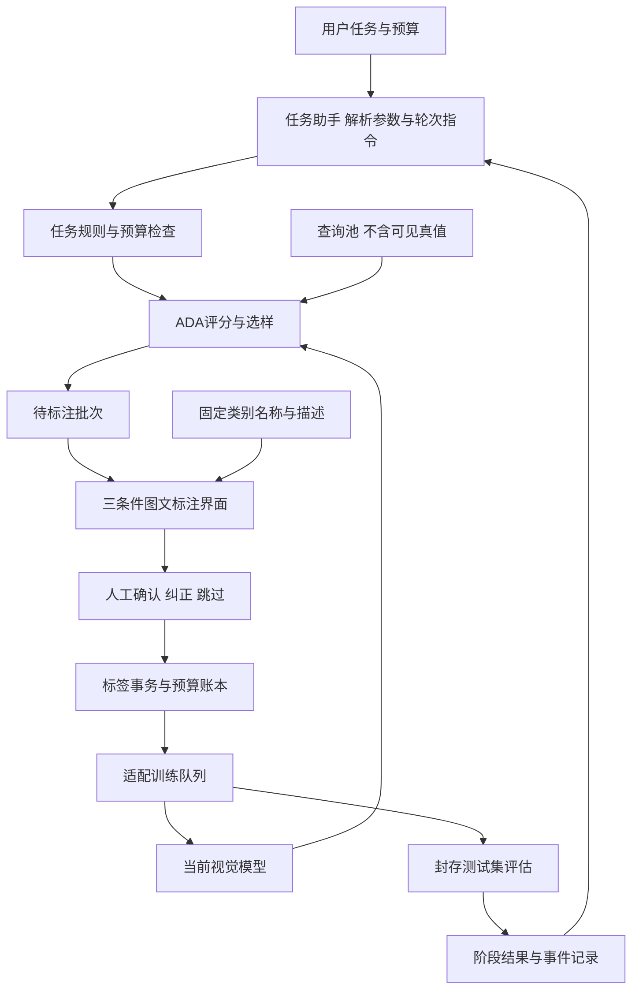

# A 图文反馈优先的适应架构

设计状态：待选型、待实现。主要研究问题：图文提示如何影响标注正确率、时间和错误依赖？

## 模块与数据流

候选类别可来自当前视觉模型，固定CLIP作为可配置的辅助来源；正式展示实验中选择一个生成规则并保持不变。文字描述、顺序与候选数量均固定版本。图文信息首先作用于人类标注环节，基础选样器保持不变，以隔离展示的作用。

## 智能体的职责边界

任务助手接收自然语言任务并形成结构化参数，读取每轮结果后提出可执行的下一步，例如继续一轮、按轮次边界暂停或调整合法预算。动作集合固定，由状态规则验证。它属于受约束的工具型助手，不声称具备开放式自主规划能力。

原型阶段可用表单直接调用同一后端；只有接入并验证语言模型与工具调用后，才能将该部分记为已实现的智能体。

## 标注流程示例

用户指定Product到Real-World及预算。系统选择一批图片，展示“图片、候选类别、类别描述”。用户可以确认候选，也可以在完整65类中纠正或跳过。只有明确提交的类别进入人工标签集合。训练完成后展示当前预算消耗与模型版本，助手根据用户指令继续或暂停。

该示例没有设定或暗示实际分类准确率。

## 最小实验

模型部分：选一种完整ADA方法与Random、Entropy、CLUE对照；区分固定训练器的选样比较与完整方法比较。

交互部分：A0图片加完整类别，A1在A0上增加候选，A2在A1上增加固定描述。完整类别入口、布局和后端能力保持一致。每位参与者使用难度匹配且不重复的图片批次，平衡顺序；建议8—12名参与者作探索性研究。

指标：正确率、每分钟正确标签数、候选遗漏时正确率、错误候选接受比例、跳过与修订次数。时间包括错误判断和跳过，不能只计正确回答的耗时。操作与模型预测日志用于解释失败案例。

## 实现顺序和风险

先做原始图片与完整类别标注，再增加候选和描述开关；接入预算事务与真实训练，最后加入有限动作的任务助手。预算校验和事件记录从第一版开始保留。

最大风险是参与者数量不足、候选错误过少以及熟悉图片导致学习效应。不能通过隐藏的人为错误夸大差异；若做压力测试应单列。没有真人数据时，仅能说明界面和流程可运行，不能证明减少人工负担。

## 论文落点与依据

第三章说明任务与交互条件，第四章描述图文反馈机制，第五章报告质量与耗时权衡。主要贡献是经过对照验证的交互设计及其适用条件。

[CLIP](https://proceedings.mlr.press/v139/radford21a.html)提供图文表征基础；[BiTTA](https://proceedings.mlr.press/v267/lee25g.html)提供反馈成本研究动机；[Bansal等](https://aiweb.cs.washington.edu/ai/pubs/bansal-chi21.pdf)与[Buçinca等](https://arxiv.org/abs/2102.09692)提示错误依赖与易用性权衡。这些文献不直接证明本架构有效。
