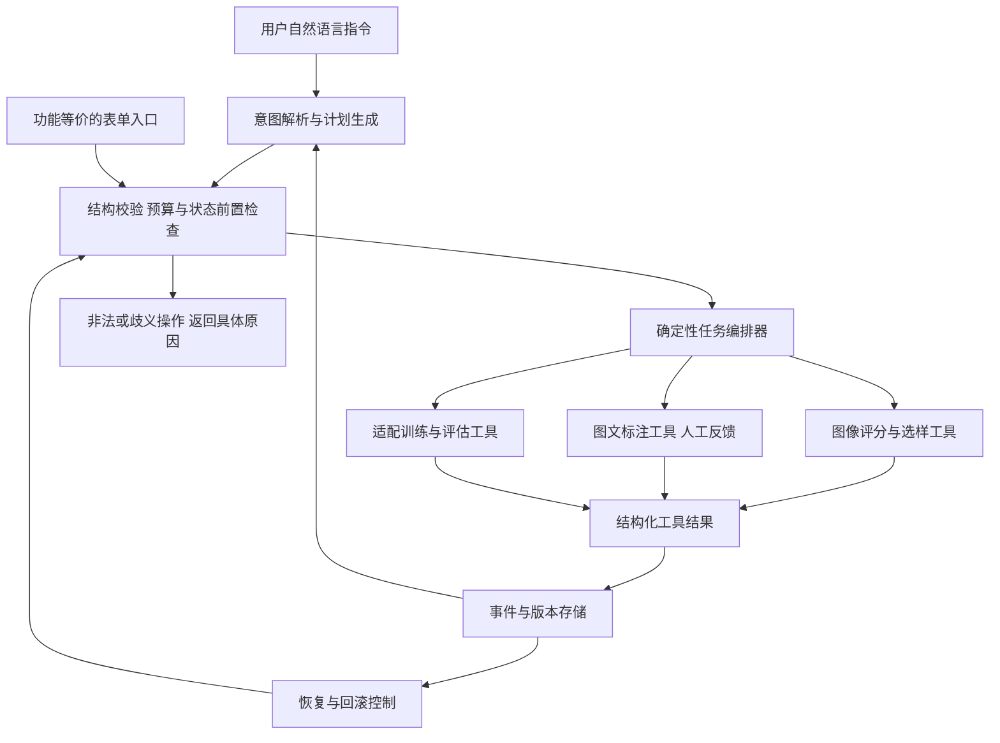

# B 受约束智能体任务编排架构

设计状态：待选型、待实现。主要研究问题：自然语言能否帮助用户完成多轮适应任务变更，后端如何保持预算、标签与模型状态一致？

## 模块与数据流

自然语言入口与表单入口均访问同一个编排器。状态机管理待查询、待标注、训练中、待评估、已暂停、已完成及失败待处理状态。模型、标签快照和任务进度分别存储并建立引用。

## 核心执行机制

计划生成器输出工具名、参数、期望状态与依赖，不直接修改数据库。校验器检查域、预算和前置条件，通过后才执行。每次反馈与训练提交携带幂等标识，重复请求返回已存在结果。

训练通过队列运行；返回任务编号与执行中状态不代表训练成功。只有检查点完整写入并登记后才能报告完成。首版采用轮次边界暂停；要支持训练中途恢复，必须额外保存并验证优化器及随机状态等信息。

模型回滚切换活动检查点，不删除标签修订历史或恢复人工预算。需要重新训练时明确引用标签快照，避免恢复旧模型却误用未声明的新标签。

## 交互流程示例

用户要求“保留已有标注，再增加20张预算，训练完这一轮后暂停”。助手读取当前预算，提出新总预算及暂停边界。校验通过后更新任务配置。若重复收到相同提交，不重复消耗预算；如果训练失败，保留标签与失败事件，按允许的重试规则继续。

## 最小实验

六类任务：创建、改预算、跳过或修订、暂停恢复、失败重试、回滚。每类约10例，总计60例作为初期任务库，事先分开开发与固定评估实例，并冻结成功判据。

比较B0功能等价表单与B1自然语言入口。两者共享同一工具、同一恢复机制、相同信息与后端状态。自动任务集验证执行可靠性；若比较真人完成时间，则另外安排匹配任务及顺序平衡的用户研究。

指标：符合终态与业务约束的任务成功率、预算超支次数、无效调用、重复生效次数、恢复一致性。耗时分开统计语言调用、工具运行和用户操作，模拟工具延迟与真实训练速度分开报告。

验证状态约束本身时，可在受控测试中禁用某项检查并比较结果；不能用自然语言与表单的对照推断状态机优于无约束系统。

## 实现顺序和风险

先实现表单加工具后端并通过状态测试，再加入自然语言参数解析；最后增加多步计划、错误处理与版本恢复。智能体的每项能力都有可查看的事件证据。

主要风险是开发内容过多、错误恢复仅在演示脚本中有效、任务集泄漏导致成功率虚高。先限制动作集合和任务类型，不引入多智能体协作或自由生成训练代码。

## 论文落点与依据

第四章重点写任务表示、受约束执行与持久化，第五章分开报告工具可靠性与自然语言入口收益。贡献来自具体机制及验证，而不是仅增加聊天界面。

[ReAct](https://arxiv.org/abs/2210.03629)提供工具交互组织思路；[LADA](https://arxiv.org/abs/2208.12856)和[EvidentialADA](https://arxiv.org/abs/2311.11367)提供适应模块参考。本架构的预算与恢复机制仍是需要实现和验证的设计。
