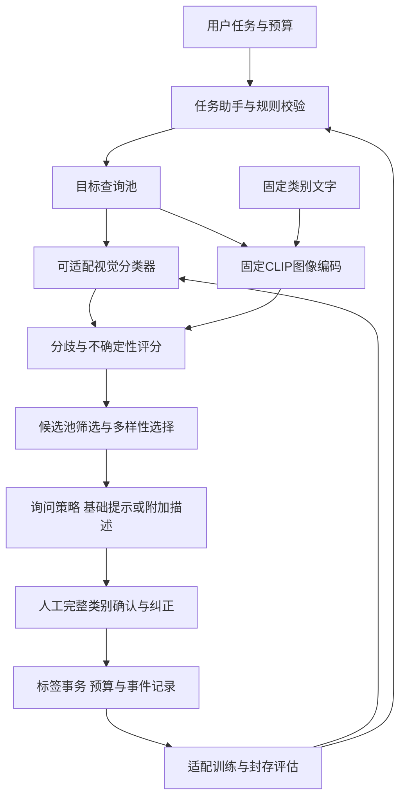

# C 双模型分歧辅助的交互适应架构

设计状态：待选型、待实现。主要研究问题：视觉与图文预测之间的分歧是否有助于选样，以及是否值得对这些样本提供更多提示？

## 模块与数据流

两个模型共享同一类别映射，但各自输出的置信分数不一定可直接比较。先实现类别预测是否一致、排名或明确归一化的分歧指标，再考虑更复杂的校准。CLIP初期冻结，视觉分类器随标签更新。

## 选样与询问机制

候选策略首先计算视觉不确定性与跨模型分歧，从查询池中形成候选集合，再用特征聚类减少冗余。权重、候选池比例和阈值在开发阶段确定并冻结，不能根据封存测试结果反复调整。

递进提示是可选的第二层机制：常规样本展示图片与候选；满足固定分歧规则的样本额外展示类别区别描述。高分歧不表示必然困难或必然有价值，需要实验分析其与错误、类别和域的关系。

主线保持完整类别反馈；不将二元对错确认和完整65类标签混记为相同反馈。如果后续增加二元反馈，单列类型、信息量及实际人工时间。

## 交互流程示例

视觉分类器和图文模型给出不同类别建议。系统记录两种预测来源，选择该样本进入待标注批次，并展示固定描述。用户选择正确类别或跳过，新增标签用于更新视觉模型，下一轮重新计算查询池评分。

示例仅解释数据流，不表示分歧策略已经产生准确率收益。

## 最小实验

选样实验：固定展示方式与训练器，比较原选择器、分歧信号、分歧加多样性；统一预算、模型初始化和数据划分，报告准确率预算曲线与额外推理耗时。

交互实验：固定样本批次及模型，比较统一提示与分歧触发提示；报告正确标签获取效率与错误接受率。两个实验分开进行，避免同时改变样本和界面而无法解释收益来源。

主要先完成选样消融。递进提示只有在基础结果、时间和参与者条件允许时加入。若分歧没有优势，应报告无改善的域、类别与候选覆盖情况，不改为仅展示最优方向。

## 实现顺序和风险

先跑通基础ADA并缓存固定CLIP特征，核对类别映射，再实现一种分歧策略，最后增加多样性与提示规则。先用单方向试验检查成本，然后扩展固定主协议。

主要风险是模型偏差相关、分歧聚集于噪声样本、校准需要额外标签和消融规模膨胀。应只保留一条策略主线，不同时引入提示微调、扩散查询、多目标域或开放集。

## 论文落点与依据

第四章描述分歧计算、选择流程与询问策略，第五章分别评估选择器与交互展示。需要将工程变体与原论文严格复现区分，不宣称技术组合本身首次提出。

[CLUE](https://openaccess.thecvf.com/content/ICCV2021/html/Prabhu_Active_Domain_Adaptation_via_Clustering_Uncertainty-Weighted_Embeddings_ICCV_2021_paper.html)、[WACV 2025主动视觉语言学习](https://openaccess.thecvf.com/content/WACV2025/html/Safaei_Active_Learning_for_Vision_Language_Models_WACV_2025_paper.html)、[CLIP-guided ADA](https://www.sciencedirect.com/science/article/pii/S0950705125021999)与[CCMA](https://arxiv.org/abs/2603.23159)提供相关研究依据；本策略的独立价值仍需实验验证。
