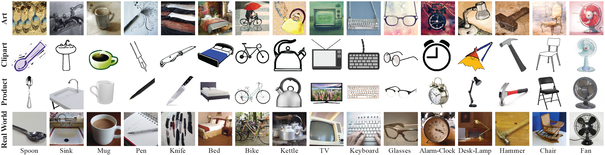
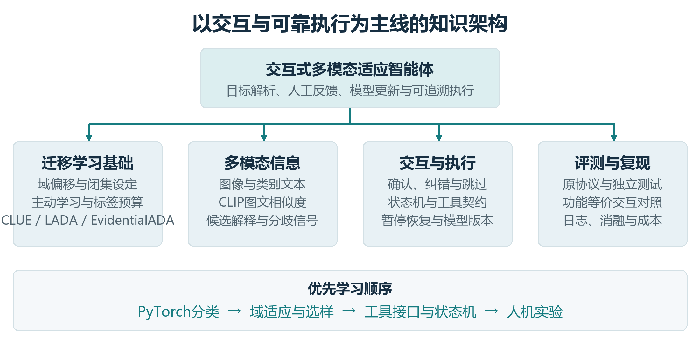
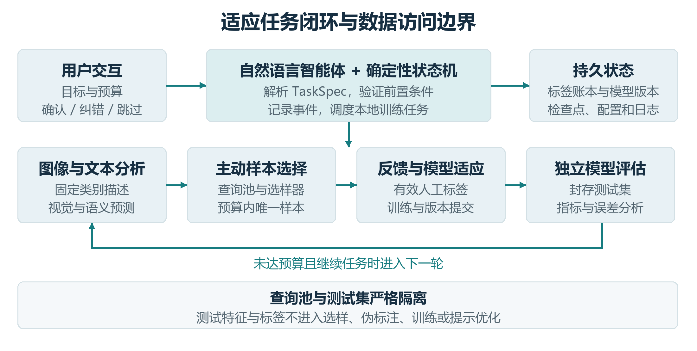
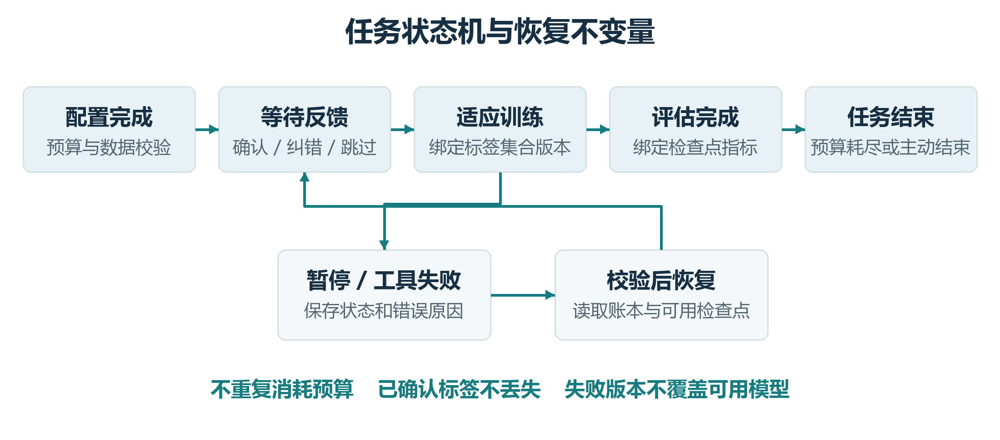
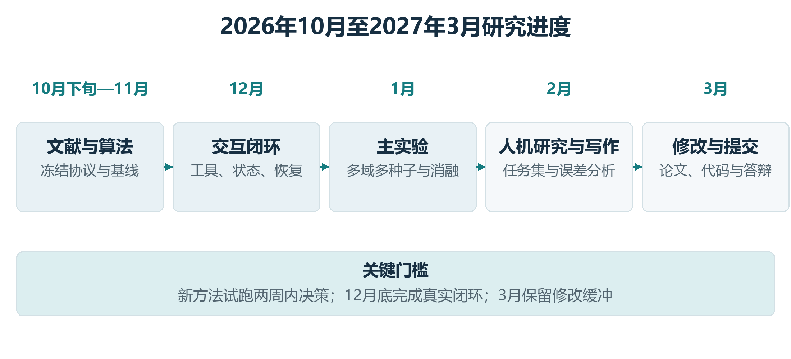

# 融合主动域适应的交互式多模态智能体研究

本科毕业论文开题报告

专业：人工智能　　研究周期：2026年10月至2027年3月

## 摘要

本课题面向有限标注预算下的跨场景物品识别，研究如何将主动域适应与图文辅助交互结合，构建能够执行、记录并恢复模型适应任务的多模态智能体。以Office-Home数据集为主要验证对象，选取商品图片向真实场景照片等迁移任务，复现具有公开实现的主动域适应方法，并与随机选样、熵选样及代表性主动域适应基线比较。系统根据用户目标和标注预算组织图像分析、样本查询、人工反馈、模型训练与评估，提供候选类别及图文证据，支持样本跳过、预算调整、中断恢复和模型版本追溯。

研究重点为交互与执行机制。算法模块承担可复现的性能基础，图文辅助询问作为可消融的扩展。实验分别评估跨域识别与标注效率，以及任务完成率、操作负担、恢复可靠性和交互质量。通过共享后端、共享选样器以及功能对等的工作流对照，区分识别算法、界面信息和智能体组织能力的影响。预期形成一个完整原型、一套可重复实验协议和相应论文材料。本文中的性能目标、实验规模和效果判断均属于待验证的研究计划。

关键词：主动域适应；多模态学习；人机协作；工具调用智能体；Office-Home

## 一 研究背景与选题意义

### 1.1 跨场景识别中的分布变化

图像识别模型通常在给定训练分布上优化，部署环境却可能改变拍摄背景、光照、纹理和对象呈现方式。例如，电商商品图片往往具有较清晰的主体与背景，真实家庭场景中则可能出现遮挡、杂物和视角变化。即使源域与目标域包含相同物品类别，图像分布的变化仍可能使识别模型性能下降。域适应研究利用源域知识和目标域信息减小这种差异，适用于目标域充分标注难以获得的任务。

Office-Home包含Art、Clipart、Product和Real-World四个域，共65个类别，是研究视觉域差异的公开基准（Venkateswara等，2017）。本课题采用闭集设定，即源域与目标域共享类别集合，优先研究Product至Real-World以及反向迁移，再扩展至风格差异更大的迁移对。数据集提供研究所需真实标签，但实验中仅由标注模拟器按预算开放查询结果，模型和选样器不能直接读取其余目标域标签。Office-Home本身是图像分类数据集，本系统所用文本来自预先固定的类别名称与描述。

图源：Office-Home数据集官方网站，2026年10月23日访问。图片用于说明域差异。

### 1.2 有限人工反馈的利用问题

主动学习通过选择少量信息价值较高的样本请求标注，减少达到给定识别质量所需的人工投入。主动域适应进一步考虑源域与目标域的分布差异，选样过程需兼顾模型不确定性、样本代表性和迁移价值。CLUE、EADA与LADA等方法分别从聚类、不确定性、能量和局部结构等角度研究这一问题。已有方法说明，标签数量相同并不意味着监督信息相同，但具体收益仍依赖模型、数据划分和预算。

真实交互还包含算法论文中常被简化的情况：用户可能无法识别某张图片，可能更改预算，也可能关闭任务后继续工作。候选类别展示方式会影响判断速度，模型预测还可能引入锚定偏差。训练失败后的重复查询或重复计费会损害信任。因此，除了选哪些图片，本课题还研究系统如何向用户提出问题、解释当前状态、保存有效反馈并可靠完成适应过程。

### 1.3 本课题的研究价值

本课题将主动域适应放入可交互的任务执行环境，连接方法复现与人机协作研究。理论与方法层面，通过统一预算和评测协议分析不同选样策略的效果；工程层面，构建具备明确状态、工具契约和可追溯版本的智能体；应用层面，考察图文证据和自然语言控制是否减轻标注与任务管理负担。研究贡献以可验证的交互机制和执行机制为主，不以训练大型基础模型或提出全新域适应理论作为完成条件。

## 二 国内外研究现状

### 2.1 域适应与主动选样

经典域适应方法通过对齐特征分布或优化目标域结构实现迁移。DANN以域对抗训练学习域不变表示，适合作为理解源域监督与分布对齐的基础。主动域适应在此基础上允许查询少量目标域标签。CLUE采用不确定性加权聚类选择兼具代表性与不确定性的样本，提供了易于理解的强基线；EADA利用能量信号研究目标域样本的迁移价值；LADA通过局部预测不一致性选择样本，并结合邻域信息改善适应。上述工作为本课题提供成熟的选样与训练模块。

复现的关键在于明确协议。论文可能使用全部目标域图像作为无标签池并在同一目标集合上报告结果，这属于特定的转导式协议；交互系统则还需要面对后续未见样本。本文同时区分原论文协议复现与独立测试集评估。只有骨干网络、初始化、划分、预算、训练损失与报告方式均保持一致时，才将结果表述为原论文复现。更换为CLIP特征或改变测试集合的实验单列为受控扩展。

2024年EvidentialADA研究将方差分解用于证据分类的不确定性估计，并在Office-Home等数据上开展主动域适应实验（Duan等，2024）。其官方实现可作为较新复现目标，但原文强调方差与熵式方法识别准确率相近，以及类别级不确定性分析的额外信息，不能预设它一定优于所有基线。2025年Certainty and Uncertainty Guided ADA结合主动查询与高置信伪标注，2026年CLIP-guided sample selection直接研究图文表征辅助ADA。两者为前沿对照，本次资料核查尚未确认可直接运行的官方实现。

本课题优先试跑EvidentialADA，在两周内检查依赖迁移、训练稳定性、日志完整性和预算协议；若仍存在难以控制的复现障碍，则以具有MIT许可和完整基线接口的LADA作为稳定主实现。EvidentialADA仓库本次未见明确LICENSE，项目材料提供原仓库链接与自编接口，不再分发原实现。

### 2.2 图文表征与轻量适配

CLIP通过图像与自然语言监督学习共享表示，能够根据类别文字提示进行视觉识别（Radford等，2021）。CoOp和Tip-Adapter等研究进一步探讨提示学习与少样本适配。这些结果为在标注界面中加入类别描述、语义相似度和视觉预测提供了工具基础，但不能直接证明图文信息在主动域适应选样中一定有效。

本课题将图文信息用于两个可区分的位置。第一，在交互界面展示图片、候选类别和统一编写的类别说明，帮助用户确认或纠正。第二，在扩展实验中，将视觉模型与图文模型的预测分歧作为查询信号之一。类别描述仅根据类别名称和通用知识编写，不能根据测试图片或隐藏标签进行优化。自然语言反馈首先映射到封闭类别集合，模糊回答要求澄清，避免把未确认文本直接作为训练标签。

2025年的Active Learning for Vision Language Models以及2026年的UnDi、双提示主动CLIP适配和Conformal Cross-Modal Active Learning进一步表明，不确定性、多样性和跨模态教师信号已形成活跃研究线索。它们的原始任务与本课题的源域监督ADA并不完全相同，移植后应作为工程扩展单列。BiTTA（ICML 2025）研究测试时二元反馈，为降低交互负担提供参考，但一次对错确认与65类完整标签的信息量不同；Tent的无监督测试时适配也不包含主动人工查询。

### 2.3 智能体与人机协作

ReAct等工作展示了推理与行动交替组织工具使用的思路。现代工具调用框架能够将语言模型输出连接到外部函数，并记录任务轨迹，但工具调用成功不等于研究任务正确完成。模型适应流程涉及预算上限、数据权限、训练状态和版本一致性等约束，需要应用层的确定性机制保障。

本文把智能体限定为围绕适应任务进行目标解析、工具选择、状态解释和异常处理的软件系统。主动选样器负责样本决策，训练器负责参数更新，评估器负责计算指标；语言模型不直接访问测试标签、不修改预算账本，也不替代人工真值标注。对固定流程的比较将包含功能对等的表单工作流，避免把新增按钮、恢复功能或记录机制本身误归因为语言模型的优势。

| 研究线索 | 代表工作 | 对本课题的启发 | 本课题需要补充的验证 |
| --- | --- | --- | --- |
| 主动域适应 | CLUE、EADA、LADA | 预算内选择有信息价值的目标样本 | 相同协议下的复现与计算开销 |
| 图文表征适配 | CLIP、CoOp、Tip-Adapter | 类别语义与视觉证据互补 | 图文询问的独立收益及锚定偏差 |
| 工具调用智能体 | ReAct、官方智能体框架 | 目标解析、工具执行与轨迹记录 | 动态任务中的完成率与恢复一致性 |
| 人机交互评价 | 人机协作与可用性研究 | 任务导向、负担与错误分析 | 功能对等对照、小样本边界说明 |

### 2.4 研究定位与边界

综合现有工作，本课题定位为主动域适应算法支撑下的交互系统研究。主要问题是：在相同模型和预算约束下，图文辅助询问和可恢复执行机制能否改善用户完成适应任务的体验及可靠性。算法先进性通过复现较新的公开方法、与传统选样对比以及充分误差分析体现。方法的新组合仅作为待验证方案，不能据此宣称已有方法未涉及、达到最优性能或首次实现。

## 三 研究目标与拟解决的问题

### 3.1 总体目标

设计并实现一个面向Office-Home跨域物品识别的交互式多模态智能体，使用户能够以自然语言或结构化方式给出迁移任务和预算，完成样本确认、模型适应与结果查看，并在任务变化或中断后保持状态一致。建立可复现的算法实验与交互实验，说明系统的收益、成本及适用范围。

### 3.2 研究问题

RQ1关注算法基础：在统一模型与标签预算下，较新的主动域适应方法相对随机选样、熵选样和CLUE是否获得更好的识别表现与标签效率，复现与原文的差异来自何处。

RQ2关注询问机制：在相同样本序列和相同候选集合下，图片加类别文字说明的展示是否减少人工判断时间和错误；进一步加入预测置信度或模型分歧解释时，收益是否伴随锚定偏差增加。

RQ3关注任务执行：在预算变更、跳过样本、中断恢复和训练失败等任务中，自然语言智能体相较功能对等的表单工作流，是否改善任务完成率、操作步数和主观负担，同时保持预算与版本一致性。

### 3.3 预期贡献形式

预期贡献包括一套图文辅助确认与纠错的交互流程、一种由语言模型和确定性状态机协同执行的适应任务组织方式，以及覆盖识别效果与交互可靠性的双轨评测协议。论文将报告失败情况和收益不显著的条件。若图文分歧选样未超过强基线，其结果仍可用于分析语义信息的适用边界，不影响以交互机制为核心的论文主线。

## 四 研究内容与知识架构

### 4.1 主动域适应模块

首先完成源域监督训练，建立目标域无标签池。每轮选样器从尚未查询的样本中生成请求集合，经人工反馈或离线真值模拟器获得标签后，调用训练器更新模型，再记录评估指标与剩余预算。算法层保留统一接口，支持随机、熵、CLUE以及选定的较新方法。原方法复现和图文扩展使用独立配置文件，保存源码版本、环境与随机种子。

### 4.2 图文辅助询问模块

询问页面展示目标图片、候选类别、简短类别说明和必要的预测依据。用户可以确认候选、选择其他类别、标记无法判断或申请稍后处理。系统将确认结果保存为结构化记录，包含样本编号、标签、时间、操作者、模型版本和交互方式。图片损坏、对象不清晰和类别边界模糊等情况允许跳过，不自动生成训练标签。

在可选扩展中，使用冻结CLIP或同类图文编码器计算类别语义预测，与当前视觉分类器形成分歧信号。候选排序可组合不确定性、预测分歧和代表性，所有权重在开发任务中确定后冻结。对照实验将逐项移除文字说明、分歧信号和代表性约束，区分界面收益与选样收益。

### 4.3 智能体编排与状态管理

智能体接收任务要求后生成结构化计划，例如源域、目标域、预算、轮数和评价指标。计划通过校验器后才能执行。工具层至少包含数据检查、图像分析、主动选样、反馈提交、适应训练、模型评估及版本查询。调用参数使用固定结构，返回值包含状态、产物路径、错误类型和可恢复信息。智能体依据返回值向用户解释进度并建议后续操作。

确定性状态机管理任务生命周期，数据库保存标注账本和版本关系。用户反馈提交采用唯一事件编号，重复请求只能产生一次有效写入；预算在事务中扣减，模型更新完成后才切换当前版本。训练失败时保留已确认标签和上一可用模型，中断恢复读取最近检查点继续执行。语言模型可提出操作请求，约束校验与实际状态变更由程序完成。

### 4.4 数据与实验记录

系统保存数据清单与哈希、训练配置、选样列表、人工反馈、指标文件和模型检查点。源域训练、目标域池和独立测试集使用互斥样本编号。训练工具仅获得允许的数据句柄，评价工具返回聚合指标。用户身份仅采用研究编号，真实照片作为补充演示时应取得授权并避免保存无关个人信息。论文附录提供配置、事件模式和运行说明，便于导师检查结果来源。

## 五 技术路线与关键设计

### 5.1 实施顺序

先建立数据与算法基线，再实现确定性工作流，随后接入自然语言智能体。这样可以把选样和训练错误与语言模型执行错误分别定位。基础界面先完成图片确认、类别搜索和预算显示，之后增加文字解释、自然语言控制和恢复提示。每次扩展必须保留与此前版本一致的后端接口。

### 5.2 预算定义与更新规则

标签预算B定义为可接受的有效目标域人工标签总数，同一样本的重复提交不重复计入。目标池规模记为N，核心实验进行五轮，每轮累计预算定义为 B_r = floor(0.01 × r × N)，r取1至5。本轮新增查询数为B_r减B_(r−1)，主要报告1%、3%和5%三个检查点，并记录实际整数标签数。选样不能调用隐藏真值来强制每类等额，除非该信息已通过合法查询获得。

跳过样本不计入标签数，却计入展示次数、交互时间和跳过率。纠正已有标签保留前后版本并单独统计人工成本。预算减少时，新预算不能小于已经消耗的有效标签数；预算增加时，需重新确认总量并记录变更事件。对离线实验，模拟器提供无噪声标签；对真实用户实验，则独立统计错误率，并研究错误反馈对适应的影响。

### 5.3 智能体可靠性约束

任务状态至少区分配置、等待反馈、训练、评估、暂停、完成和失败。只有合法状态转换才能触发工具。恢复操作以持久化记录为依据，不能依赖对话历史推测已执行的动作。每个训练任务绑定标签集合版本和父模型版本，评估结果绑定具体检查点。界面展示的“当前模型”和“本轮结果”必须引用同一版本。

系统应通过故障注入验证这些约束：在标注写入前后断开、训练启动后退出、工具超时、重复提交反馈、预算下调和模型文件缺失。预期行为由测试用例预先定义，包括不重复扣费、已确认标签不丢失、失败模型不覆盖有效模型，以及恢复后结果与连续执行的一致性。

### 5.4 实现条件

采用Python与PyTorch完成数据处理、特征提取和训练，使用轻量Web界面承载交互，并以SQLite或同类本地数据库保存状态。RTX 5070 Ti可用于单卡实验，具体显存容量、驱动、CUDA与PyTorch兼容性须在实验启动时测量确认。PyTorch 2.7已引入Blackwell与CUDA 12.8支持，旧论文环境需要迁移至支持硬件的版本，并记录由此产生的配置变化。先使用较小批量和冻结特征缓存测算耗时，依据实际资源确定并行任务数，避免把显卡型号直接等同于已验证的训练速度。

语言模型作为可替换的编排组件。可依据官方OpenAI文档采用应用自主控制的Agents SDK或函数调用接入本地工具与结构化输出，也可使用满足接口约束的本地模型。JSON结构约束仅保障参数格式，预算、数据权限和状态前置条件仍由业务程序检查。论文固定实际使用的模型版本和调用参数，记录响应延迟、调用次数和费用。主算法实验不依赖在线语言模型，网络不可用时仍能执行确定性适应流程。若使用外部API，实验开始前另行确认访问条件和预算。

## 六 实验设计与评价指标

### 6.1 数据划分与任务规模

以Office-Home为主数据集，先完成Product至Real-World的端到端验证，再进行反向迁移与其他预先选定任务。核心方案固定六个方向：Pr至Rw、Rw至Pr、Ar至Rw、Rw至Ar、Cl至Rw、Rw至Cl。资源允许时补齐四域之间的十二个有向迁移任务。任务选择在正式比较前固定，不根据方法表现临时筛选。每种方法至少采用三个随机种子，报告逐任务结果以及均值和标准差。

系统评估使用固定的目标域80%查询池与20%封存测试集，源域以80%训练、20%验证划分。划分器可使用标签进行分层，但随后将标签权限隔离；测试图片的特征及标签均不进入选样、伪标注、提示优化或训练。若使用目标验证集调参，明确其标签来源与数量，所有方法共享同一额外开发预算，并在表格中独立披露。核心实验优先沿用原论文配置或使用源域验证集确定超参数，正式目标域实验冻结配置。与原论文表格比较时另建原协议复现实验，避免混合两个协议的数值。

### 6.2 算法效果实验

| 实验组 | 控制条件 | 主要回答的问题 |
| --- | --- | --- |
| Source-only | 相同源域初始化，目标标签预算为0 | 域偏移下的基础识别水平 |
| Random与Entropy | 相同训练器、轮数、标签预算 | 主动选择是否优于随机以及简单不确定性 |
| CLUE与较新ADA方法 | 遵守各方法原设定，另做受控比较 | 复现先进方法及其成本 |
| 图文辅助扩展 | 同骨干、同训练器，逐项加入信号 | 语义信息或分歧是否产生独立收益 |

选择器受控对比共享同一模型检查点与适配损失。完整方法对比则共享数据划分、ImageNet预训练骨干与标签预算，并保留各自的分类头、损失和训练机制；EvidentialADA的证据分类头与LADA配置不同，不要求它们共享同一个源模型检查点，也不将其全部差异归于选样器。

主要指标为目标域Top-1准确率、宏平均类别准确率，以及准确率随累计标签数变化的曲线；Macro-F1作为补充指标。标签效率使用相同预算下的性能和归一化学习曲线面积描述。达到指定性能所需标签数只在各方法确实达到预先定义阈值时比较。补充报告训练时长、显存峰值和选样开销，避免忽略方法带来的额外计算成本。若更换骨干获得收益，应归于整体配置变化，并通过同骨干对照判断选样贡献。

### 6.3 交互与执行实验

交互评价包含离线脚本任务和小规模用户实验。离线任务集设置创建任务、预算修改、跳过或重标、暂停恢复、工具失败重试、版本回滚六类，每类10个实例，共60个任务。使用模拟工具或预计算结果时明确标注，并另行完成真实训练闭环，不能把模拟耗时当成模型训练速度。对照组包括固定脚本、支持同等功能的表单工作流、自然语言智能体。三组共享数据、选样器、训练器和状态存储机制。固定脚本用于呈现自动批处理的边界，表单工作流承担智能体增益的主要公平对照。

用户实验拟招募8至12名具备基本计算机操作能力的志愿者，采用被试内设计，平衡不同界面条件的顺序，并使用难度相近但不重复的任务集合。参与者先完成统一训练任务，正式实验记录任务完成时间、成功率、错误数、操作步数和主观负担。视觉标注设置图片加全类别、图片加候选、图片加候选与描述三个条件，尽量固定或匹配样本难度，控制候选锚定偏差。小样本结果以效应大小、个体差异和置信区间为主，定性访谈用于解释异常，不作广泛人群推广。

### 6.4 分层指标与分析

| 评价层 | 主要指标 | 解释边界 |
| --- | --- | --- |
| 识别能力 | Top-1、宏平均类别准确率、预算曲线 | 不等同于交互体验 |
| 标注效率 | 单次有效标注时间、错误率、跳过率 | 展示时间与标签数量分开报告 |
| 执行可靠性 | 成功率、恢复成功率、重复提交率、预算违规数 | 通过预定义任务和日志核验 |
| 用户体验 | 操作步数、主观负担、可理解性 | 小样本探索，保留个体差异 |
| 使用成本 | 训练耗时、显存、模型调用延迟与费用 | 固定硬件和软件版本后比较 |

智能体成功需同时满足任务目标和一致性条件，例如预算未超限、数据版本正确且检查点可加载，不能仅凭语言模型声称完成判定。对恢复任务，比较恢复后标签集合、预算账本和模型配置的一致性。对交互收益，单独分析文字描述、置信度展示与自然语言控制的影响，避免把多个改动合并后无法解释来源。

### 6.5 结果可信度与统计计划

正式实验前冻结任务、指标和随机种子列表。训练结果报告均值与标准差，用户实验报告配对差值和适合样本规模的区间估计。分析方法根据数据分布和样本量选择，不把统计显著性作为唯一判断依据。实验失败、未达阈值和效果反向的任务均保留记录。所有图表只使用真实运行结果，开题阶段的路线图和结构图属于方法示意，不作为实验结果。

## 七 可行性分析与风险控制

### 7.1 资源与工作量

本课题已具备人工智能专业背景和单卡实验设备条件，主任务规模为公开图像分类数据集，适合分阶段开展。主要工作包括环境配置、算法复现、交互原型、状态管理、实验与论文写作。将大模型预训练、多目标复杂规划、开放世界识别以及长期在线学习列为后续研究，不纳入核心毕业验收。

### 7.2 主要风险

| 风险 | 触发条件 | 应对措施 |
| --- | --- | --- |
| 新方法难以复现 | 代码缺失、依赖老旧或协议不明 | 两周内完成可运行性检查，保留LADA/CLUE稳定底座 |
| 显存或耗时超预算 | 试运行资源不满足计划 | 特征缓存、减小批量、先六个迁移方向再扩展 |
| 图文选样收益有限 | 消融未优于强基线 | 保留负结果，聚焦询问方式和执行机制 |
| 语言模型调用不稳定 | 超时、结构错误、参数越界 | 校验器、重试上限、确定性恢复与表单入口 |
| 用户实验招募有限 | 样本量不足或熟练度差异大 | 以任务日志和故障注入为主，用户研究作为探索证据 |
| 时间不足 | 复现和系统集成延迟 | 优先完成可运行闭环、核心对照及关键恢复测试 |

### 7.3 最低完成范围与增强范围

最低完成范围为：至少一个可复现ADA方法与Random、Entropy、CLUE对比，六个迁移方向、三个种子、五轮预算实验，完整可恢复人工反馈闭环，功能等价工作流对照，以及一项图文信息消融。两个主迁移任务用于前期调通，不替代正式六方向实验。增强范围包括十二个迁移方向、图文分歧选样消融和用户体验实验。任何扩展均以核心实验和论文进度完成为前提，避免增加模块却无法完成可靠评估。

## 八 进度安排与预期成果

| 时段 | 主要工作 | 可检查的阶段成果 |
| --- | --- | --- |
| 2026年10月23日至11月8日 | 文献、环境、数据划分与基线 | 开题报告、数据清单、试运行记录 |
| 11月9日至11月30日 | 较新ADA试跑与协议冻结 | 复现配置、两周选型决策、差异说明 |
| 12月1日至12月31日 | 交互界面、工具后端、状态机与日志 | 真实一轮闭环、反馈账本、恢复测试 |
| 2027年1月1日至1月24日 | 多域多种子主实验与信息消融 | 预算曲线、对照表和消融结果 |
| 1月25日至2月14日 | 交互任务与探索性用户研究 | 任务日志与访谈，预留春节缓冲 |
| 2月15日至3月7日 | 论文写作、图表与失败分析 | 论文初稿、系统演示与答辩PPT |
| 3月8日至3月21日 | 导师修改与提交缓冲 | 终稿、代码、配置和演示材料 |

预期提交一篇本科毕业论文、一套可运行的交互式多模态智能体、一组主动域适应复现与对照实验，以及包含数据划分、配置、日志和复现说明的项目材料。答辩演示重点展示用户设定预算后完成一次适应任务，并演示样本跳过、预算变更和中断恢复。论文将明确哪些能力来自已有方法，哪些设计由本课题实现，哪些效果获得实验支持。

## 九 参考文献

[1] Ganin Y, Ustinova E, Ajakan H, et al.. Domain-Adversarial Training of Neural Networks. Journal of Machine Learning Research, 17(59): 1–35, 2016. https://www.jmlr.org/papers/v17/15-239.html

[2] Venkateswara H, Eusebio J, Chakraborty S, Panchanathan S. Deep Hashing Network for Unsupervised Domain Adaptation. CVPR 2017, 2017. https://openaccess.thecvf.com/content_cvpr_2017/papers/Venkateswara_Deep_Hashing_Network_CVPR_2017_paper.pdf

[3] Radford A, Kim J W, Hallacy C, et al.. Learning Transferable Visual Models From Natural Language Supervision. ICML 2021, PMLR 139: 8748–8763, 2021. https://proceedings.mlr.press/v139/radford21a.html

[4] Prabhu V, Chandrasekaran A, Saenko K, Hoffman J. Active Domain Adaptation via Clustering Uncertainty-Weighted Embeddings. ICCV 2021: 8505–8514, 2021. https://openaccess.thecvf.com/content/ICCV2021/papers/Prabhu_Active_Domain_Adaptation_via_Clustering_Uncertainty-Weighted_Embeddings_ICCV_2021_paper.pdf

[5] Zhou K, Yang J, Loy C C, Liu Z. Learning to Prompt for Vision-Language Models. International Journal of Computer Vision, 2022. https://arxiv.org/abs/2109.01134

[6] Zhang R, Zhang W, Fang R, et al.. Tip-Adapter: Training-free Adaption of CLIP for Few-shot Classification. ECCV 2022, 2022. https://arxiv.org/abs/2207.09519

[7] Sun T, Lu C, Ling H. Local Context-Aware Active Domain Adaptation. ICCV 2023, 2023. https://openaccess.thecvf.com/content/ICCV2023/papers/Sun_Local_Context-Aware_Active_Domain_Adaptation_ICCV_2023_paper.pdf

[8] Du Z, Li J. Diffusion-Based Probabilistic Uncertainty Estimation for Active Domain Adaptation. NeurIPS 2023, 2023. https://proceedings.neurips.cc/paper_files/paper/2023/hash/374050dc3f211267bd6bf0ea24eae184-Abstract-Conference.html

[9] Xiao W, Gu J, Liu H. Category-Aware Active Domain Adaptation. ICML 2024, PMLR 235: 54276–54287, 2024. https://proceedings.mlr.press/v235/xiao24b.html

[10] Zhang L, Xu L, Motamed S, Chakraborty S, De la Torre F. D3GU: Multi-Target Active Domain Adaptation via Enhancing Domain Alignment. WACV 2024, 2024. https://arxiv.org/abs/2401.05465

[11] Safaei B, Patel V M. Active Learning for Vision Language Models. WACV 2025: 4902–4912, 2025. https://openaccess.thecvf.com/content/WACV2025/html/Safaei_Active_Learning_for_Vision_Language_Models_WACV_2025_paper.html

[12] Safaei B, Vibashan VS, Patel V M. Certainty and Uncertainty Guided Active Domain Adaptation. IEEE ICIP 2025, 2025. https://arxiv.org/abs/2505.19421

[13] Li Z, Meng M, Liu J, Wu J. CLIP-guided sample selection for active domain adaptation. Knowledge-Based Systems, 335: 115165, 2026. https://doi.org/10.1016/j.knosys.2025.115165

[14] Wang Q W, Song Y, Xia S T. Explicit Uncertainty Modeling for Active CLIP Adaptation with Dual Prompt Tuning. arXiv:2602.04340, 2026. https://arxiv.org/abs/2602.04340（预印本，正式接收状态尚未核实）

[15] Nguyen H H, Jung C, Salehi S, Glück T, Schmeink A, Kugi A. Conformal Cross-Modal Active Learning. arXiv:2603.23159, 2026. https://arxiv.org/abs/2603.23159（预印本，正式接收状态尚未核实）

[16] Yang F, Ren K, Shen J, Chen M, Du Y. Uncertainty and diversity based selection for active learning in vision-language models. Information Fusion, 133: 104260, 2026. https://doi.org/10.1016/j.inffus.2026.104260

[17] Lee T, Chottananurak S, Kim J, Shin J, Gong T, Lee S J. Test-Time Adaptation with Binary Feedback. ICML 2025, PMLR 267: 33005–33024, 2025. https://proceedings.mlr.press/v267/lee25g.html

[18] Wang D, Shelhamer E, Liu S, Olshausen B, Darrell T. Tent: Fully Test-Time Adaptation by Entropy Minimization. ICLR 2021, 2021. https://arxiv.org/abs/2006.10726

[19] Duan R, Caffo B, Bai H X, Sair H I, Jones C. Evidential Uncertainty Quantification: A Variance-Based Perspective. WACV 2024, 2024. https://openaccess.thecvf.com/content/WACV2024/html/Duan_Evidential_Uncertainty_Quantification_A_Variance-Based_Perspective_WACV_2024_paper.html

[20] Xie B, Yuan L, Li S, Liu C H, Cheng X, Wang G. Active Learning for Domain Adaptation: An Energy-Based Approach. AAAI 2022, 36(8): 8708–8716, 2022. https://ojs.aaai.org/index.php/AAAI/article/view/20850

[21] Yao S, Zhao J, Yu D, Du N, Shafran I, Narasimhan K, Cao Y. ReAct: Synergizing Reasoning and Acting in Language Models. ICLR 2023, 2023. https://arxiv.org/abs/2210.03629

[22] OpenAI. Agents SDK; Function calling; Agent evaluations. 官方开发文档，访问日期2026-10-23. https://developers.openai.com/api/docs/guides/agents/sdk ; https://developers.openai.com/api/docs/guides/function-calling ; https://developers.openai.com/api/docs/guides/agent-evals

[23] PyTorch Team. PyTorch 2.7 Release Blog. 2025. https://pytorch.org/blog/pytorch-2-7/

